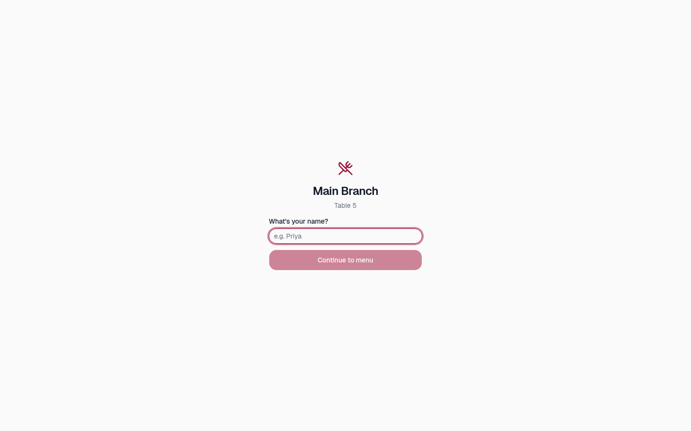
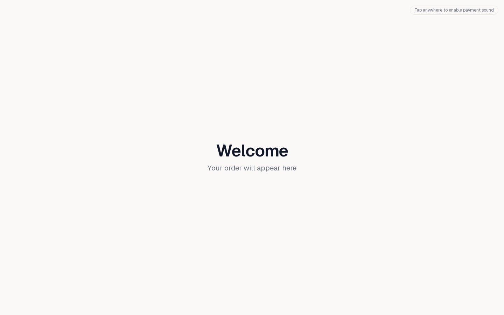
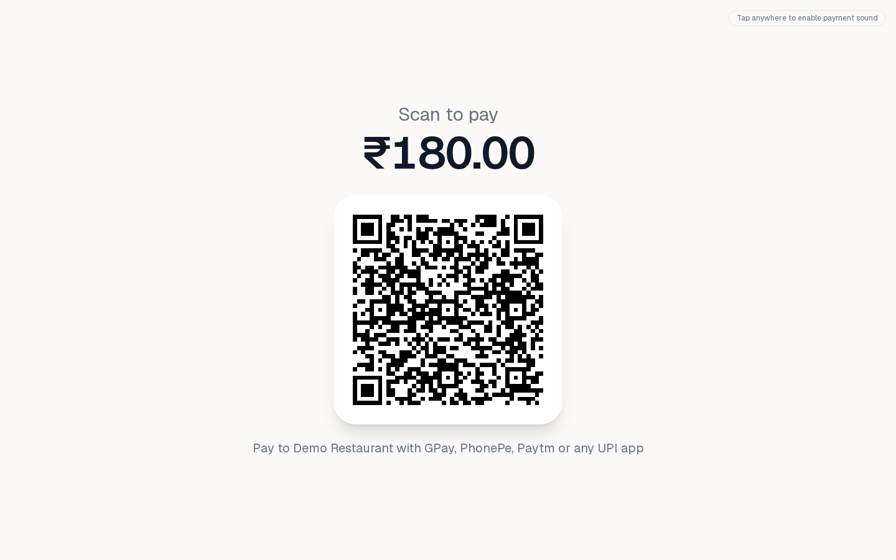
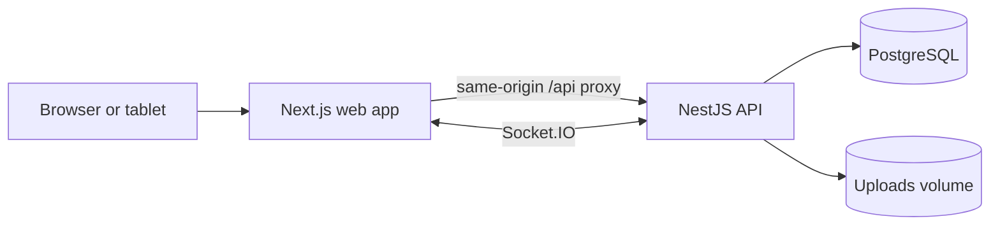

<div align="center">


<h1>Restaurant service, in one place.</h1>

**Bhojan is a self-hosted restaurant operations platform for taking orders, serving the kitchen, managing stock, and running the business from one system.**

Built for independent restaurants and multi-branch teams that want to run their own point of sale and keep operational data on infrastructure they control..

[](LICENSE)
[](package.json)
[](apps/web/package.json)
[](apps/backend/package.json)
[](docker-compose.yml)
[](ROADMAP.md)

[Quick start](#quick-start) · [Features](#what-bhojan-includes) · [Screenshots](#screenshots) · [Development](#local-development) · [Documentation](#documentation) · [FAQ](#faq)

</div>

<p align="center">
  
</p>

## Quick start

Requirements: Docker Engine or Docker Desktop with Docker Compose v2, Git, and `curl`. The one-click installer also needs Bash. On macOS use Docker Desktop; on Windows use Docker Desktop with WSL2 or Git Bash; on Linux install Docker Engine and the Compose plugin and ensure your user can access the Docker daemon.

```bash
git clone https://github.com/ankanz1/Bhojan.git
cd Bhojan
./install.sh
```

The installer creates a `.env` with generated secrets if one does not already exist, builds and starts the Compose services, then waits for the API health check. Open **http://localhost:1995** and create the first restaurant account at **/signup**. A normal install starts without demo data.

To load sample restaurant data instead, run `./install.sh --demo`. Demo-only sign-in: `owner@demo.local` / `Password123!`. Change or remove this account before using the installation for real operations.

See [Manual Docker Compose setup](#manual-docker-compose-setup) for environment configuration and [Troubleshooting](#troubleshooting) if startup does not complete.

## What Bhojan includes

The following capabilities are implemented in the current application. Details and scope limits are in the [roadmap](ROADMAP.md).

- **Point of sale and billing:** dine-in, takeaway, and delivery orders; modifiers; discounts; tips; gift-card and loyalty redemption; refunds; and cash, card, and UPI payment recording.
- **Menu and pricing:** categories, items, images, modifier groups, combos, scheduled availability, recipe costing, and branch tax settings.
- **Tables and reservations:** floor and table management, waitlist, reservations, table transfers, and guest QR table ordering.
- **Kitchen operations:** live Kitchen Display System, kitchen order tickets, station routing, preparation status, reprints, and kitchen activity views.
- **Inventory and procurement:** ingredients, recipes, stock deductions, suppliers, purchase requests and orders, quotations, goods receipts, batch/expiry records, stock transfers, and waste logging.
- **Customers and loyalty:** customer profiles and visit history, points ledger, and gift cards.
- **Staff operations:** staff accounts and granular roles, attendance, shifts, leave requests, payroll calculations, and tip-pool allocation.
- **Accounting and reporting:** expenses, cash closing, budgets, tax summaries, financial reports, CSV/Excel/PDF exports, and scheduled report email through configured SMTP.
- **Delivery and branches:** delivery zones and fees, driver assignment and delivery status, branch switching, cross-branch overview, and stock transfers.
- **Payments and integrations:** amount-specific UPI QR display, a customer-facing payment screen, REST integration API keys, personal API keys for MCP clients, signed webhooks, and SMTP email.
- **Security and administration:** httpOnly cookie-based authentication, optional TOTP two-factor authentication, role and permission checks, audit logs, backups and restore, and restaurant/branch settings.

### Scope and verification notes

- UPI QR codes display the payee and amount. Bhojan does not connect to a payment gateway or independently verify settlement; staff record the payment in the app.
- Delivery status and driver assignment are included. Live GPS tracking and third-party delivery-platform connectors are not.
- Equal split is a display calculator; separate checks or split tender are not implemented. Loyalty uses a fixed earn/redeem rate rather than configurable membership tiers.
- ESC/POS printing transports are implemented, but physical printer compatibility must be checked with the hardware used at each site.
- Tax settings and invoice features do not certify legal compliance. The [VERI*FACTU notes](docs/verifactu.md) document what is implemented and what has not been verified against AEAT’s live services.
- Bhojan is under active development. Review the [roadmap](ROADMAP.md) and validate your own deployment, data-retention, backup, tax, and hardware requirements before relying on it for business operations.

## Screenshots

These are real guest-facing screens from Bhojan.

<table>
  <tr>
    <td align="center"><br><sub>QR table ordering</sub></td>
    <td align="center"><br><sub>Customer display</sub></td>
  </tr>
  <tr>
    <td align="center"><br><sub>UPI amount QR</sub></td>
    <td align="center"><br><sub>Payment confirmation display</sub></td>
  </tr>
</table>

## Manual Docker Compose setup

Use this path if you want to review or set configuration values yourself.

```bash
git clone https://github.com/ankanz1/Bhojan.git
cd Bhojan
cp .env.example .env
```

Edit `.env` before starting. Set unique random values for `POSTGRES_PASSWORD` and `JWT_SECRET` (for example, generate each with `openssl rand -hex 32`). Keep `.env` private; it contains deployment secrets and is ignored by Git. The installer generates these values automatically only when `.env` is absent.

```bash
docker compose up -d --build
```

The web application is published on port **1995** by default. Set `HOST_PORT` in `.env` to use another host port. Create the owner account at `http://localhost:1995/signup`. PostgreSQL and uploaded files use persistent Compose volumes.

For HTTPS deployments behind a reverse proxy or tunnel, set `FRONTEND_ORIGIN` to the public origin and `COOKIE_SECURE=true` after TLS is configured. Do not enable secure cookies while serving plain HTTP; browsers will reject the session cookie.

The optional `./install.sh --demo` path seeds sample restaurant data. The ordinary installer does not seed sample users or data.

### Updating a Docker installation

From the project checkout, fetch the desired source update and rebuild the services:

```bash
git pull
./install.sh
```

The installer rebuilds and restarts the application services. It does not overwrite an existing `.env`; Compose volumes retain the database and uploads. For a manual installation, use `docker compose up -d --build` after updating the source. Back up important data before upgrades and keep a separate copy of `.env` in a secure location.

## Local development

Local development requires Node.js 22 or newer, pnpm 11.10.0 (available through Corepack), and a PostgreSQL server reachable at the `DATABASE_URL` in `apps/backend/.env`.

```bash
pnpm install
cp apps/backend/.env.example apps/backend/.env
```

Edit `apps/backend/.env` with a valid local database URL and a unique `JWT_SECRET`, then run migrations and start both apps:

```bash
(cd packages/types && pnpm build)
(cd apps/backend && pnpm prisma:migrate)
pnpm dev
```

The web app runs at **http://localhost:3000** and the backend listens on **http://localhost:4001**. Keep the backend port private to the development machine; the web app proxies API requests through `/api`.

Useful workspace commands:

| Command                                 | Purpose                                                 |
| --------------------------------------- | ------------------------------------------------------- |
| `pnpm dev`                              | Run the web and backend development servers             |
| `pnpm build`                            | Build all workspace packages and applications           |
| `pnpm lint`                             | Run workspace lint checks                               |
| `pnpm typecheck`                        | Run workspace TypeScript checks                         |
| `pnpm test`                             | Run backend and web unit tests                          |
| `(cd apps/backend && pnpm prisma:seed)` | Load demo data into the configured development database |

For a Docker-backed local app, use the [quick start](#quick-start) instead. The Compose PostgreSQL service is internal to the Compose network and is not published on the host by default.

## Technology and architecture

| Area                        | Implementation                                                              |
| --------------------------- | --------------------------------------------------------------------------- |
| Monorepo                    | pnpm workspaces and Turborepo                                               |
| Web application             | Next.js App Router, React, TypeScript, Tailwind CSS                         |
| Backend API                 | NestJS, TypeScript, REST, Swagger/OpenAPI                                   |
| Database                    | PostgreSQL with Prisma migrations                                           |
| Realtime updates            | Socket.IO for kitchen, table, and order status views                        |
| Shared validation and types | Zod schemas and TypeScript types in `packages/types`                        |
| Deployment                  | Docker Compose services for web, backend, PostgreSQL, and the update helper |



The browser uses the Next.js web service as its same-origin API proxy. In development, Swagger is enabled by default at `/api/docs`; production Swagger is opt-in with `ENABLE_SWAGGER=true`.

## Monorepo layout

```text
apps/
  web/            Next.js application and browser-facing routes
  backend/        NestJS API, Prisma schema, migrations, and seed data
packages/
  types/          Shared API types, validation schemas, and domain helpers
docs/             Integration, operations, and product documentation
packaging/        Debian package and service scripts
windows/msix/     Windows desktop launcher packaging
docker-compose.yml
install.sh
```

## Documentation

- [Screenshot-guided tutorial](TUTORIAL.md) — first-run setup and common workflows.
- [Architecture](ARCHITECTURE.md) — application boundaries and deployment design.
- [Product scope](PROJECT.md) and [roadmap](ROADMAP.md) — implementation decisions, completed work, and deferred items.
- [REST and MCP integration guide](docs/integrations-api.md) — API keys, scopes, routes, and MCP tools.
- [Kiosk and Kitchen Display](docs/KIOSK-AND-KDS.md) — operational behavior and setup notes.
- [Permissions, stock, and printing](docs/PERMISSIONS-STOCK-PRINTING.md) — role permissions and implementation details.
- [India compliance notes](COMPLIANCE-INDIA.md) — technical context for operators; not legal advice.
- [VERI*FACTU implementation notes](docs/verifactu.md) — implemented scope and verification limitations.
- [Contributing](CONTRIBUTING.md) — development conventions and contribution workflow.

## Troubleshooting

- **Docker is unavailable:** start Docker Desktop or the Docker Engine service, then confirm `docker compose version` works.
- **The installer cannot reach the app:** inspect `docker compose ps` and `docker compose logs`; wait for PostgreSQL health and backend startup.
- **Port 1995 is already in use:** set another `HOST_PORT` in `.env`, then rerun the installer or Compose command.
- **Sign-in works but later requests return Unauthorized over HTTPS:** set `COOKIE_SECURE=true` only when the public site is served over HTTPS, and make `FRONTEND_ORIGIN` match that origin.
- **A browser on another device cannot connect:** use the server’s LAN address and ensure the host firewall permits the configured web port.
- **A local-development API request fails:** confirm the PostgreSQL URL and `JWT_SECRET` in `apps/backend/.env`, apply migrations, and check that the backend is listening on port 4001.

## FAQ

**Does Bhojan require a cloud account?** No. The standard deployment runs on your own Docker host. Optional email and external integrations require their respective services.

**Can I use it without internet access?** The core web, API, and database services run locally. Features that contact external systems, such as SMTP delivery or remote integrations, require network access.

**Does the UPI QR confirm that a payment arrived?** No. The QR presents payment details; staff must confirm settlement through their payment app or bank and record the payment in Bhojan.

**Does it support payment gateways or delivery marketplaces?** Not currently. Payment gateway checkout and third-party delivery-platform connectors are not implemented.

**Where are API docs?** Read the [integration guide](docs/integrations-api.md). Swagger is available by default in development at `/api/docs`; production must opt in.

**Is the software certified for tax compliance?** Bhojan does not claim tax certification. Tax configuration is provided for supported regimes; operators should confirm their obligations with a qualified professional. VERI*FACTU support has not been tested against the tax authority’s live services.

## License and attribution

Bhojan is distributed under the [GNU Affero General Public License, version 3.0](LICENSE) (AGPL-3.0-only).

See [LICENSE](LICENSE) for the full legal terms and applicable copyright attribution.
